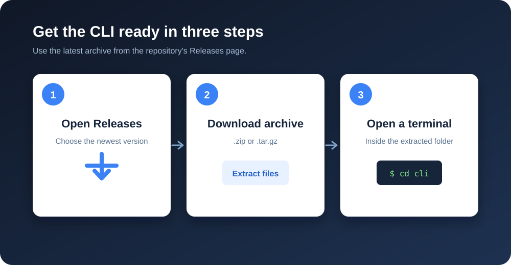
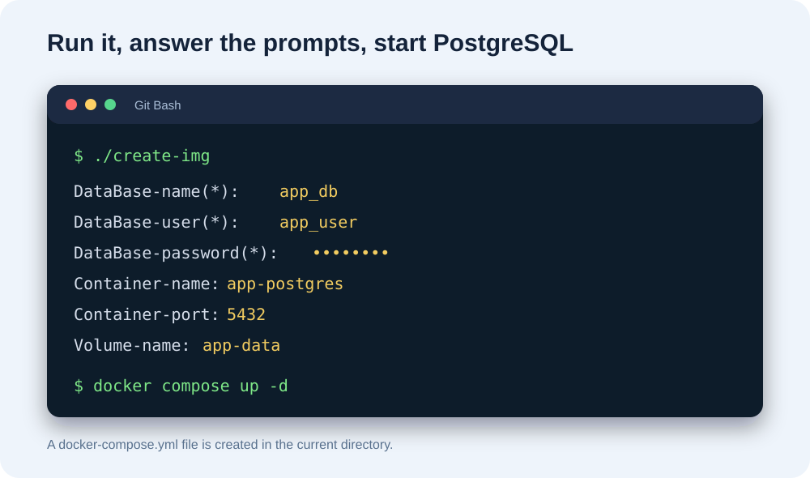

# Postgres Image Creation CLI

Create a ready-to-run PostgreSQL Docker Compose file from a short interactive
prompt. The CLI asks for database credentials and optional container settings,
then writes a `docker-compose.yml` in the current directory.

## Prerequisites

- [Docker](https://docs.docker.com/get-docker/)
- **Git Bash** on Windows, or another Bash-compatible terminal

## Setup

### Running the tool from a release

Download the latest archive from the repository's **Releases** page, extract it,
and open a terminal in the extracted folder.



Choose the command for your environment:

**Git Bash, Linux, or macOS**

```shell
 create-img
```

**NOTE**: for now the cli is executes and runs inside bash supported terminals meaning windows cmd, powershell are not yet supported

The script asks for the database name, user, password, and optional container
settings. For example:



### Use the default container settings

Use the `-D` option when you want to skip the container-information prompts.
This tells the script to use the default container settings:

- **Container name:** the database name
- **Container port:** `5432`
- **Volume name:** `database-data`

```shell
create-img -D
```

The database name, user, and password are still requested because they are
required to configure PostgreSQL.

After the prompts finish, start PostgreSQL with:

```shell
docker compose up -d
```

> The command creates `docker-compose.yml` in the directory where you run the
> script. Run it from a new project directory to keep the generated file
> separate from the CLI files.

### Running from the repository

Clone the repository if you want to use the source code:

```shell
git clone https://github.com/jabo-arnold-landry/Postgres-image-creation-cli.git
cd Postgres-image-creation-cli
./create-img
```

The generated Compose file contains the PostgreSQL image, credentials, port,
container name, and persistent volume configuration.
